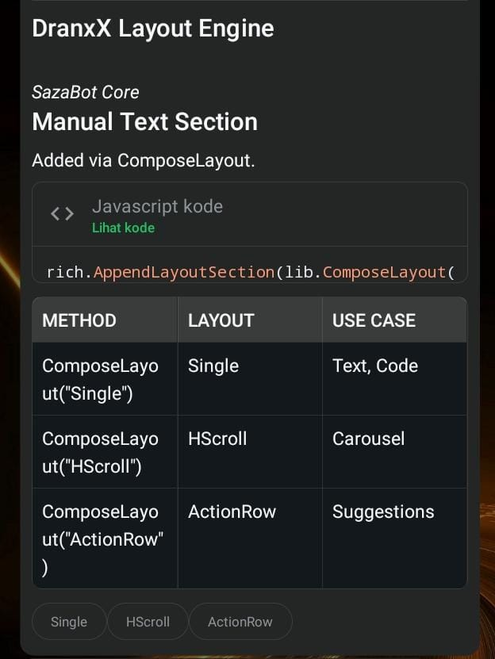

<p align="center">
  
</p>
<h1 align="center">Saza-Bot</h1>
<p align="center">
  A Super fast and lightweight <strong>Go + whatsmeow</strong> WhatsApp bot starter with plugins, SQLite stores, rich responses, and automatic reconnection.
  <br/>Add a <code>.go</code> file to <code>plugins/</code>, register it in <code>init()</code>, then rebuild.
</p>

<p align="center">
  
  
  
  
  
</p>

---

[`Versi Bahasa Indonesia`](README_ID.md)

## What is Saza-Bot?

**SAZA (Smart Assistant with Zero-delay Answer)** is a lightweight WhatsApp bot with super fast response for **starter/template**, not a finished production bot. It provides:

- multi-device WhatsApp connectivity through [whatsmeow](https://github.com/tulir/whatsmeow)
- QR and phone pairing login
- self-registering Go plugins using `init()`
- reply, edit, mention, reaction, deletion, media, and presence helpers
- AI Rich Response, native-flow buttons, selection lists, and carousels
- SQLite-backed session, ban, and premium data
- LID ↔ phone identity resolution
- group metadata and blocklist caches
- multi-alias spam protection
- automatic reconnection with exponential backoff.

<table align="center">
  <tr>
    <td align="center">
      
      <br>
      <sub><b>⚡Super Fast Answer⚡</b></sub>
    </td>
    <td align="center">
      
      <br>
      <sub><b>Meta AI Style</b></sub>
    </td>
  </tr>
</table>


## Requirements

- **Go 1.25+**
- **git**
- No `gcc` is required by default because the project uses pure-Go SQLite (`modernc.org/sqlite`)

## Install

```bash
git clone <repo-url> template-go
cd template-go
cp config.json.example config.json
nano config.json # edit phone number
go mod tidy
make run
```

Build a binary instead:

```bash
make build
./template-go
```

| Command | Purpose |
|---|---|
| `make run` | Run with `go run .` |
| `make build` | Tidy modules and build `template-go` |
| `make tidy` | Download and tidy Go dependencies |
| `make reset-session` | Delete the session database and force a new login |
| `make clean` | Remove the built binary |

> `go run .` enables an experimental plugin watcher. Changed plugin files are compiled as Go plugins where `-buildmode=plugin` is supported. Restarting `make run` or rebuilding remains the most reliable workflow.


## Documentation

| Document | Description |
|---|---|
| [`docs/eng/creating-plugins.md`](docs/eng/creating-plugins.md) | Go plugin guide, `Ctx` reference, messaging, target resolution, premium, and hooks |
| [`docs/eng/rich-messages.md`](docs/eng/rich-messages.md) | AIRich, native-flow buttons, selection lists, media headers, and carousels |
| [`docs/id/creating-plugins.md`](docs/id/creating-plugins.md) | Indonesian plugin guide |
| [`docs/id/rich-messages.md`](docs/id/rich-messages.md) | Indonesian rich-message reference |

## Configuration

Copy `config.json.example` to `config.json`. Phone numbers must contain digits only, without `+`, spaces, or punctuation.

```json
{
  "name": "Saza-Bot",
  "owner": "6289876543210",
  "bot": "6281234567890",
  "prefix": ".",
  "status": "public",
  "autoread": "enable",
  "loginMethod": "qr",
  "markdown": true
}
```

| Field | Type | Required | Description |
|---|---|---:|---|
| `name` | string | No | Display name defaults to `Template Go`. |
| `owner` | string | Yes | Owner number with access to owner commands. |
| `bot` | string | Recommended | Bot number, used for pairing and identity checks. |
| `prefix` | string | No | Command prefix defaults to `.`. |
| `status` | string | No | `public`, `ponly`, `gonly`, or `self`. |
| `autoread` | string | No | `enable` or `disable`. |
| `loginMethod` | string | No | `qr` or `pairs`. |
| `markdown` | boolean | No | A hint for plugins WhatsApp renders basic markdown natively. |

Invalid values are normalized. `.set` and `.setp` update and persist `config.json` at runtime.

## Login

For QR login, set `"loginMethod": "qr"`, start the bot, and scan the terminal QR from **WhatsApp → Linked Devices → Link a Device**.

For phone pairing, set `"loginMethod": "pairs"` and configure `bot` or `owner`. If neither is set, the terminal asks for a number.

Session data is stored in `db/session/template-session.db`. Run `make reset-session` to force a new login.


## Built-in Commands

| Command | Category | Description |
|---|---|---|
| `.menu` / `.help` | info | Show commands by category |
| `.profile` | info | Show premium status and credits |
| `.msgbuild` / `.airich` | info | Demonstrate rich and interactive messages |
| `.hello` / `.hi` | info | Example Go plugin |
| `.ping` / `.stats` / `.status` | utility | Latency, CPU, RAM, platform, and uptime |
| `$ <command>` | owner | Run a shell command with a 30-second timeout |
| `.set <mode>` | owner | Set `public`, `ponly`, `gonly`, or `self` mode |
| `.setp <prefix>` / `.setprefix` | owner | Change and persist the prefix |
| `.ban <target> [duration]` | owner | Add a permanent or temporary ban |
| `.unban <target>` | owner | Remove a ban |
| `.listban` / `.banlist` | owner | List banned users |
| `.addprem <target> [duration]` | owner | Add or update premium access |
| `.delprem <target>` | owner | Remove premium access |
| `.listprem` | owner | List premium users and credits |

Durations support `s`, `m`, `h`, and `d`, including combinations such as `1d12h`. An omitted duration means permanent. Targets can be supplied by reply, mention, direct number, or—inside a private chat—the other participant by default.

## Minimal Plugin

```go
// plugins/info-hello.go
package plugins

import "context"

func init() {
    Register(&Plugin{
        Command:     []string{"hello", "hi"},
        Description: "Send a greeting",
        Category:    "info",
        Handler: func(_ context.Context, c *Ctx) error {
            return c.Replyf("Hello %s!", c.PushName)
        },
    })
}
```

Save the file, then restart `make run` or rebuild. Common categories are `ai`, `info`, `utility`, `downloader`, `owner`, and `hidden`.

## Rich Message Example

```go
import "template-go/lib"

return lib.NewComposer(c.Client).
    WithHeader("Search Results").
    AppendText("Results for *Saza-Bot*.").
    AppendCode("go", "fmt.Println(\"hello\")").
    AppendTable([][]string{
        {"File", "Purpose"},
        {"main.go", "Entry point"},
    }).
    AppendSuggestedPills([]string{"Menu", "Profile"}).
    DispatchMessage(ctx, c.Chat, c.Event)
```

Additional builders are `NewActionComposer`, `NewSimpleFlow`, and `NewCarouselComposer`.

## Persistence and Protection

```text
db/
├── session/template-session.db
├── banned/banned.db
└── premium/premium.db
```

The databases use SQLite WAL, `synchronous=NORMAL`, and a 5-second busy timeout. Bans match phone and LID aliases. Premium users receive 10 credits per calendar month, lazily reset when accessed in a new period.

Command spam protection counts only prefixed commands (plain chats are just logged), deduplicates redelivered messages by ID, warns on the fourth command within one second, and applies a one-minute temporary ban on the fifth. Phone, LID, and JID aliases share one counter.

## Architecture

```text
Startup
  → load config and initialize SQLite stores
  → connect or start QR/pairing login
  → whatsmeow event handler
      ├── connection events → reconnect/session recovery
      ├── group updates → cache invalidation
      ├── call offers → reject
      └── messages → handler.Handle()

Message pipeline
  → reject stale/broadcast/protocol messages
  → unwrap ephemeral/view-once/document wrappers
  → extract text, type, quote, mentions, and sender
  → resolve LID, blocklist, and cached group metadata
  → apply status mode
  → run every Before hook
  → parse prefix or "$ " and normalize Unicode command text
  → plugin lookup → ban → spam → autoread
  → execute plugin handler
```

## Directory Structure

```text
template-go/
├── main.go
├── config/                  # Thread-safe config and persistence
├── handler/                 # Message pipeline, caches, spam protection
├── plugins/                 # Registry, Ctx helpers, built-in plugins
├── lib/                     # Rich response and interactive builders
├── store/                   # Ban, premium, and identity stores
├── docs/                    # Indonesian and English documentation
└── db/                      # Runtime databases, generated automatically
```

## Compatibility Notes

- Rich and interactive messages rely on internal WhatsApp protobufs and may change with WhatsApp/whatsmeow versions.
- Runtime plugin watching uses Go `plugin` it is generally available on Linux/macOS and unavailable natively on Windows. Normal rebuilding remains portable.
- `.ping` reads `/proc` for host CPU/RAM details, so full host metrics are Linux-specific.


## License and Credits

MIT — free for personal and commercial use. Base created by **[@DranxX](https://github.com/DranXX)**.

Powered by [whatsmeow](https://github.com/tulir/whatsmeow) and pure-Go SQLite through [`modernc.org/sqlite`](https://pkg.go.dev/modernc.org/sqlite).
